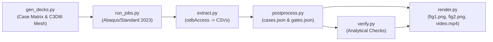

# physics-by-agents

**Reproducible engineering simulation studies built for automated execution: parametric solver decks, closed-form verification gates, and headless field rendering.**

Each study in this repository packages an end-to-end, code-driven finite-element workflow—from geometry and mesh generation to solver execution, analytical cross-checks, and publication figures—without manual GUI steps or committed binary bloat.

---

## Studies

| Study | Scope | Solver & Element | Decks |
|---|---|---|---|
| [`studies/rib-vs-thickness`](studies/rib-vs-thickness/) | Equal-mass (`80,000 mm³`, `216 g`) `200 × 100 mm` `6061-T6` lid: `4.0 mm` monolithic plate vs. `2.5 mm` skin + `10 × 15 mm` rib (`4-edge` vs. `2-edge` support, rib height sweep, `3 mm` fillet variant) | `Abaqus/Standard 2023` (`C3D8I`, quarter-symmetry) | 19 |

---

## Engineering & Verification Principles

- **Code-first, headless execution:** Decks are generated parametrically (`gen_decks.py`), solved in batch (`run_jobs.py`), and post-processed directly from `.odb` files via `odbAccess` (`extract.py`).
- **Explicit convergence & singularity discipline:** Headline deflection (`w_center`) and converged rib-tip stresses are gated across mesh refinements (`B` → `C`), while non-convergent features—such as sharp `90°` rib-root stress singularities—are explicitly flagged as mesh-dependent and never quoted.
- **Closed-form verification:** `verify.py` checks solver outputs against analytical beam/plate references using frozen tolerances (`results/verify.json`).
- **Zero-GUI software rendering:** `render.py` generates unsmoothed nodal-averaged field plots and animations (`fig1.png`, `fig2.png`, `video.mp4`) using `numpy`, `matplotlib`, `Pillow`, and `imageio`—no `pyvista`, `cv2`, or system `ffmpeg` binary required.
- **Lean repository:** Large raw `nodes_*.csv` and `faces_*.csv` exports are excluded from git and regenerated locally from solver runs.

---

## Pipeline Overview



---

## Quickstart (`rib-vs-thickness`)

### Prerequisites

- **Solver:** `Abaqus/Standard 2023` on `PATH` as `abq2023` (or set `ABAQUS_CMD=/path/to/abq2023`).
- **Python:** `3.9+` with `numpy` (and `matplotlib`, `Pillow`, `imageio`, `imageio-ffmpeg` for rendering).

### Run

```bash
cd studies/rib-vs-thickness

python code/gen_decks.py --list          # inspect the 19-case matrix
python code/run_jobs.py --cpus 8         # generate decks, solve, extract CSVs
python code/postprocess.py               # build results/cases.json + gates.json
python code/verify.py --measure          # evaluate closed-form tolerances -> verify.json
python code/render.py all                # render fig1.png, fig2.png, video.mp4
```

See [`studies/rib-vs-thickness/README.md`](studies/rib-vs-thickness/README.md) for mesh-convergence notes and file-by-file details.

---

## Repository Layout

```text
physics-by-agents/
├── README.md
└── studies/
    └── rib-vs-thickness/
        ├── README.md
        └── code/
            ├── gen_decks.py     # parametric all-hex C3D8I deck generator & case matrix
            ├── run_jobs.py      # batch solver runner + Abaqus Python extraction trigger
            ├── extract.py       # odbAccess reader (U, nodal-averaged S, faces, volume, reactions)
            ├── postprocess.py   # case aggregation & pass-gate evaluation
            ├── verify.py        # closed-form analytical verification checks
            └── render.py        # pure-Python software rasterizer for figures & video
```
